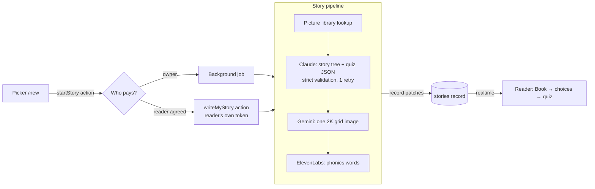

# StorySprout 🌱📖

**Choose-your-own-adventure picture books for early readers (grades 1–3, ages 6–10), written about whatever the child loves, at their reading level, with phonics and comprehension practice.**

**Live:** https://storysprout.app.space · **Sample story (no sign-in):** https://storysprout.app.space/demo

A child picks a reading level and up to three things they love (chips like *Dinosaurs* or *Outer space*, or their own typed idea). StorySprout writes a brand-new illustrated adventure in about a minute. Every page is half picture, half text. At each fork the child decides what happens next. Any word can be tapped to hear it read aloud. At the end, five questions check what they understood and how words sound.

Built on [DeepSpace](https://docs.deep.space) (Cloudflare Workers + Durable Objects) as a build exercise.

---

## What a reader gets

| | Grade 1 | Grades 2–3 |
|---|---|---|
| Story shape | 3 nodes: a beginning, **one choice**, two endings | 7 nodes: **two choices**, four endings |
| Pages | Every node is 2 pages; each page is the top half a picture, the bottom half text | same |
| Words per page | 18–28 | 28–40 (grade 2) · 38–52 (grade 3, aimed at a 3rd–4th grade level) |
| Pictures | one 3×2 grid → 6 page pictures | one 4×4 grid → 14 page pictures + a cover + an ending picture |

- **Choices:** a "What should *Lila* do next?" spread with two options, each previewing the first picture of where it leads. The back arrow lets the child change their mind, and "Try the other path" at The End goes back to the last choice.
- **Tap any word** to hear it spoken by *Hope*, a warm, childlike ElevenLabs voice. Tricky (phonics) words are highlighted.
- **Five end-of-story questions about the branch the child actually read:** three comprehension questions (what happened, in what order, and why), then two pronunciation questions (rhymes, matching sounds; never syllable counting), with Hope saying the word.
- **Bookshelf** with covers and best quiz scores.
- **Text fits the page:** type scales with the page size, then shrinks until the text fits its half.

## How it uses DeepSpace

| DeepSpace piece | What StorySprout does with it |
|---|---|
| **Integrations** (`anthropic/chat-completion`, `gemini/generate-image`, `elevenlabs/generate-speech`) | Claude Haiku writes the story tree and questions as strict JSON. Gemini draws all pictures as one grid image at 2K. ElevenLabs records the phonics words and tapped words. |
| **Server actions** (`src/actions/index.ts`) | The trust boundary for everything paid: input validation, daily caps, who pays, the owner-only tools. |
| **Background jobs** (`AppJobRoom`, `src/jobs.ts`) | The ~1-minute generation pipeline runs outside the HTTP request when the owner pays. |
| **Records + RBAC + realtime** | Each stage of the pipeline patches the story record, and the reader's open page fills in live (text, then pictures, then audio) with no polling. Readers can only read their own stories and quiz attempts. Caches and the library are server-only. |
| **R2 file storage** (`appFiles`) | Picture sheets and recordings: private per reader, or public for the shared picture library and word cache. |
| **Auth** | Sign-in for the picker and bookshelf; the sample story is public. |



## Design decisions and tradeoffs

**The budget shaped the product.** The free tier has 500 credits ($5) that don't renew. Every cost was measured from the usage log:

| Item | Measured cost |
|---|---|
| Story writing (Claude Haiku, incl. an occasional retry) | ~$0.02 |
| 4×4 picture grid at 1K (`gemini-2.5-flash-image`) | ~$0.07–0.08 |
| 4×4 picture grid at 2K (`gemini-3.1-flash-image-preview`) | ~$0.67–0.72 |
| A recorded word | ~$0.002 |

- **One grid image per story, not one image per page.** It costs about the same as a single picture and keeps the characters identical from panel to panel. The reader **finds the panels in the image** (`src/story/panels.ts`) rather than cutting fixed tiles, because the model draws uneven margins and thin frames. Tested on real sheets, including darkened corners and narrow margins.
- **2K pictures, paid for by readers.** 1K panels looked soft on half a page, and the 1K model lost track of panel order on 16-panel grids. 2K fixed both at ~10× the price. So `OWNER_PAYS = false`: every story asks the reader to use their **own** DeepSpace credits (about 75 per story), and nothing is spent until they agree. Setting `OWNER_PAYS = true` restores owner-paid stories with daily caps and an automatic switch to reader-paid when the owner's credits run out.
- **Shared picture library.** A whole grid image is reused (partial reuse saves nothing, since one grid costs the same for 1 panel or 16). When a new story has the same tree size and exactly the same interest chips as a saved sheet the reader hasn't seen, Claude writes a **new** story to fit those pictures, and no image is generated. Stories with a typed idea are never shared, because a typed idea can be personal ("my cat Pepper").
- **Shared word cache.** A tapped word is recorded once, ever, then served to every reader for free.
- **Claude Haiku over Sonnet.** Sonnet was ~60% of an early story's cost. Strict validation plus one retry catches weaker drafts.

## Security

- **Paid calls only happen server-side.** The scaffold's `/api/integrations/*` browser proxy refuses the three paid integrations (a `serverOnly` flag in `src/integrations.ts`); otherwise any signed-in browser could spend the owner's credits.
- **The job queue can't be written from a client** (`authorizeWrite: () => false`). Only the `startStory` action enqueues, so the caps and the verified user id can't be bypassed. Only admins can read the queue, since payloads name other readers' stories.
- **A reader-paid story runs with the reader's token inside their own request.** The token is never stored. A background job has no caller token, which is why reader-paid stories don't use the job.
- **Records:** stories can't be created or edited from the client at all (only by actions and the job). Readers can read and delete only their own stories. The word cache, usage counters and picture library are server-only.
- **Owner tools** (`redrawPictures`, who-pays settings) check `OWNER_USER_ID` on the server, whatever the UI shows.
- **Untrusted input is checked:** model output is validated field by field (`parseStory`), and typed ideas are cleaned and capped.

## Project layout

```
src/
  story/        catalog.ts   reading levels, interests, types, limits, OWNER_PAYS
                tree.ts      the adventure tree: paths, panels, the quiz for a path
                prompts.ts   prompts + strict validation of model output
                panels.ts    finding panels in a grid image (pure, unit tested)
                voice.ts     Hope's ElevenLabs voice settings
  actions/      server actions: startStory, writeMyStory, sayWord, deleteStory,
                redrawPictures, ownerSettings, setReadersPay
  jobs.ts       the generation pipeline (shared by the job and writeMyStory)
  schemas/      stories, quiz_attempts, word_clips, usage, picture_library
  components/story/  Book (spreads, choices, page text), Panel, Quiz, Phonics, Reader
  pages/        /, /demo, /home (bookshelf), /new (picker), /story/:id
scripts/export-demo.mjs   turns a generated story into the static /demo sample
```

## Running it

Requires Node 22.15+/24+, npm 11.6+, and a DeepSpace account.

```bash
npm install
npx deepspace auth login
npx deepspace dev start          # http://localhost:5173
npx vitest run                   # 33 unit tests
npx deepspace deploy             # → https://<name>.app.space
```

> **Windows:** use an uppercase drive path (`C:\...`) for tests. With a lowercase `c:\...` working directory (Git Bash starts Node that way), Vitest loads twice and every test file fails. The same casing issue once made the production bundle include React Router twice and crash. `vite.config.ts` now normalizes the drive letter for builds.

To refresh the public sample: generate a good story locally, then run `node scripts/export-demo.mjs <storyId>`. It copies the story, its pictures and recordings into `public/demo/`, so the sample is served as static files at no cost.

## Known limitations and next steps

- **Reader-paid billing has only been tested with the owner's own account.** Billing a different reader's account, and how new accounts are credited, still needs testing with a second account.
- **A reader-paid story runs inside the reader's browser request.** Closing the tab mid-story can stop it; after 10 minutes it shows as stuck with Try again and Remove. A durable version would need a way to bill the reader from the background job.
- **Pictures can drift from the text.** The image model occasionally leaves a character out of a panel. Nothing checks the image against the story.
- **Library matching is exact** (same interest chips). Matching similar stories (embeddings over scenes) would increase reuse.
- **No playwright end-to-end tests yet** for signed-in flows. Verification so far is unit tests, scripted browser runs of the public sample on desktop and phone, and manual testing of signed-in flows.
- Next: a parent view of reading progress, read-to-me narration as a paid option, and spaced practice for words a child got wrong.

## How it was built

Built in two days by Katherine Karpova, directing Claude Code (an AI coding agent). The agent wrote most of the code and checked its work with tests, real-image checks and scripted browser runs. Katherine made the product decisions and tested it in the browser, which surfaced several fixes: the choose-your-own-adventure format, Hope's voice, half-picture pages, 2K pictures paid by readers, bigger page layout, the Enter-key behaviour in the picker, and the picture quality.
